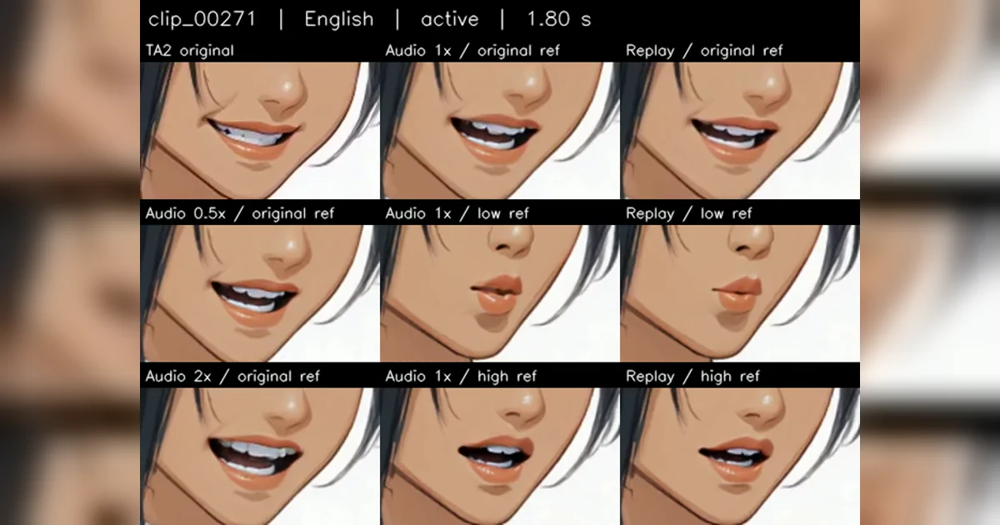
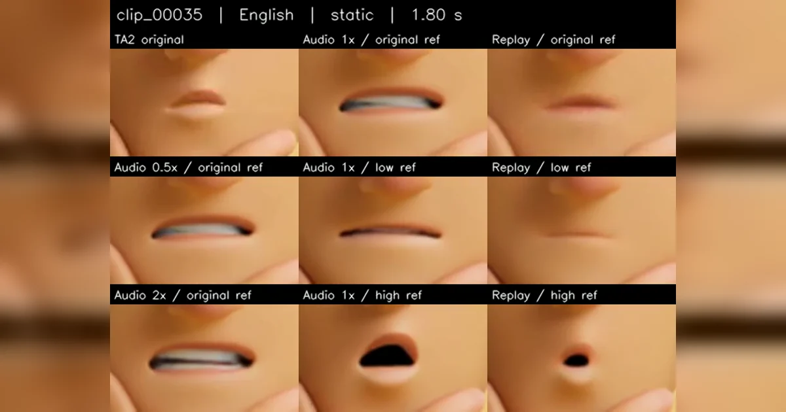
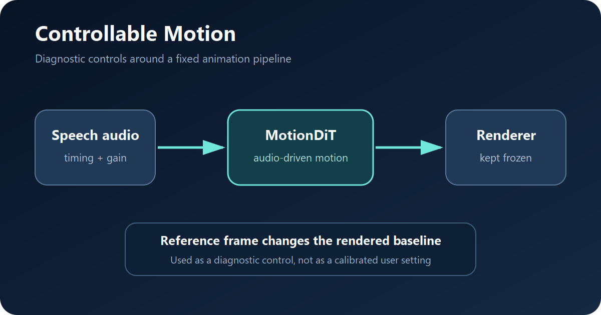
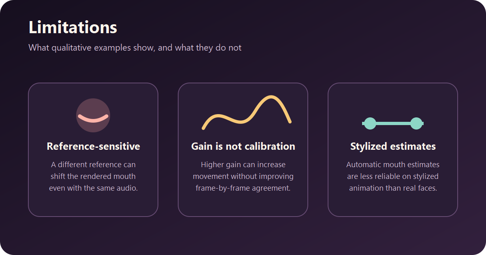

# AnimLip

Audio-driven talking-face and lip-sync research for real faces and animation.

<a href="assets/demos/ta2-korean-fullface.mp4">
  
</a>

[Watch with audio · MP4](assets/demos/ta2-korean-fullface.mp4)

AnimLip collects a reviewable record of experiments in audio-conditioned facial motion, rendering, synchronization, controllable motion, and visible teeth. The archive keeps demonstrations close to the experiment notes that describe their conditions.

## Watch selected samples

<table>
  <tr>
    <td width="50%" align="center">
      <a href="assets/demos/ta2-e350-english.mp4"></a><br>
      English E350 sample
    </td>
    <td width="50%" align="center">
      <a href="assets/demos/ta2-compare.mp4"></a><br>
      TA2 comparison sample
    </td>
  </tr>
  <tr>
    <td width="50%" align="center">
      <a href="docs/demos.md#controllable-motion"></a><br>
      Controllable motion
    </td>
    <td width="50%" align="center">
      <a href="docs/demos.md#limitations"></a><br>
      Limitations and observed failure cases
    </td>
  </tr>
</table>

These are selected demonstrations. Their clips make individual behaviors easier to inspect. [Benchmark notes](experiments/ta2-benchmark.md) carry the evaluation setup, cohort coverage, and qualifications for comparative results.

## Research snapshot

The five-model TA2 snapshot includes n=14 same-pair samples driven by original audio and n=7 cross-audio samples driven by replacement audio. The archive preserves the strict held-out split from the recorded evaluation. Generation coverage varies by model and condition. The benchmark record preserves those coverage differences.

The latest regression test records MAE of 0.3589 for Wav2Vec2 and 0.3653 for Whisper-small. [Teeth-visibility notes](experiments/teeth-visibility.md) provide the verified findings, scope, and protocol.

```text
audio
  -> temporal facial-motion inference
  -> talking-face rendering
  -> synchronized frames and evaluation
```

## Explore the archive

- [Experiment index](experiments/index.md) maps each result to its status and source record.
- [LNet and SyncNet](experiments/lnet-syncnet.md) traces lower-face and synchronization studies.
- [KoNet](experiments/konet.md) records the Korean evaluation work.
- [Ditto and MotionDiT](experiments/ditto-motiondit.md) covers motion generation and the frozen renderer.
- [TA2 benchmark](experiments/ta2-benchmark.md) documents the cohort, coverage, and metric context.
- [Teeth visibility](experiments/teeth-visibility.md) records the visibility encoder experiment.

## Reproduce and cite

[Reproducibility notes](reproducibility/README.md) distinguish score replay, fresh inference with available assets, and report-only results. [Data and licenses](docs/data-and-licenses.md) identifies source material, attribution, and redistribution boundaries.

The repository presents a research record with documented evidence and representative media. Read the linked experiment pages before comparing results across models or conditions.
